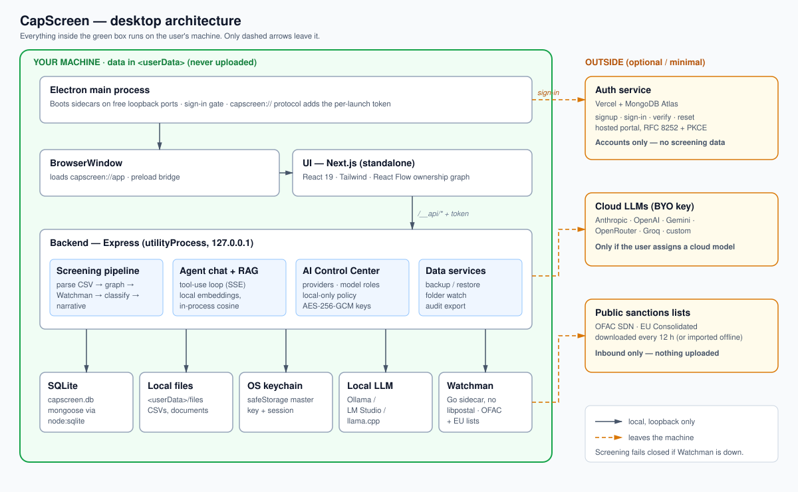
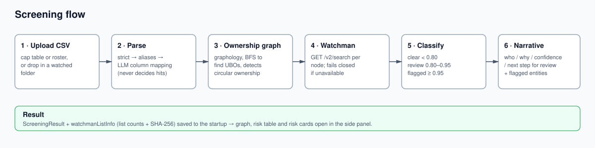

# CapScreen — VC Sanctions & Cap-Table Screener

A **desktop app** (Electron) for venture firms. Upload a startup cap table (CSV), screen every owner, including UBOs behind shell-company layers, against OFAC/EU sanctions lists, and get a plain-English risk report with an ownership graph, entity table and AI-written analyst notes.

**It never decides guilt.** It narrows the review set for a human compliance officer.

**Your data stays on your computer.** Cap tables, documents and screening results live in a local SQLite database and local files. AI runs on-device (Ollama / LM Studio) or with your own cloud API keys, chosen in the in-app **AI Control Center**. The only cloud piece is a small auth service for accounts.

---

## Download

**[CapScreen v1.0 for macOS (Apple Silicon)](https://github.com/devxsubh/CapScreen/releases/tag/v1.0)** — grab the `.dmg` from the release assets. The build is unsigned: right-click the app and choose **Open** on first launch.

**[Watch the 40-second product video](https://github.com/devxsubh/CapScreen/releases/download/v1.0/capscreen-promo.mp4)**

---

## Features

- **Cap-table screening** — CSV upload (strict format, column aliases, or AI-inferred schema) for cap tables and flat entity rosters
- **Ownership graph** — interactive React Flow graph with flagged / review highlighting and circular-ownership detection
- **AI analyst notes** — who matched, why, how confident, and the suggested next step
- **Agentic chat** — follow-up questions against stored results via tool-use, plus local document RAG
- **AI Control Center** — pluggable providers (Anthropic, Ollama, OpenAI-compatible), model roles, local-only policy, keys encrypted with the OS keychain
- **Data & backup** — sanctions-list versions, background re-screening, folder watch, encrypted backup/restore, audit export
- **Sign-in like Claude Code** — browser + PKCE, session sealed in the OS keychain

---

## Architecture



| Piece | Where | Role |
|---|---|---|
| **Electron main** | `desktop/src/main.ts` | Starts sidecars on free loopback ports, sign-in gate, `capscreen://` protocol that proxies the UI and `/__api/*` (adds the per-launch token) |
| **UI** | `frontend/` | Next.js (App Router, React 19, Tailwind, shadcn/ui, React Flow), built `output: "standalone"` |
| **Backend** | `backend/` | Express in a `utilityProcess`, loopback-only, token-gated; screening, chat, RAG, AI Control Center |
| **Database** | `<userData>/capscreen.db` | SQLite through a MongoDB-driver-compatible store (`node:sqlite`) under mongoose; vector search is in-process cosine |
| **Watchman** | bundled Go binary | OFAC SDN + EU Consolidated matching (`GET /v2/search`) |
| **Secrets** | OS keychain | Electron `safeStorage` seals the master key and session |
| **Auth service** | Vercel + MongoDB Atlas | Accounts only: signup, sign-in, verify, reset, desktop OAuth (RFC 8252 + PKCE). No screening data |

`<userData>` is `~/Library/Application Support/CapScreen` (macOS) or `%APPDATA%/CapScreen` (Windows).

**Network egress** is limited to public sanctions-list downloads (every 12 h), auth sign-in, and cloud LLM calls, which happen only if you assign a cloud model. Local-only mode blocks the latter.

Deeper docs: **[docs/DESKTOP_PLAN.md](docs/DESKTOP_PLAN.md)** · **[AGENTS.md](AGENTS.md)**

---

## Screening flow



1. Parse CSV into ownership records (strict, column aliases, or LLM schema inference)
2. Build a directed ownership graph ([graphology](https://graphology.github.io/)) and traverse chains (BFS) to surface UBOs
3. Screen each node via [Watchman](https://github.com/moov-io/watchman)
4. Classify: **clear** (< 0.80) / **review** (0.80–0.95) / **flagged** (≥ 0.95)
5. The LLM writes who/why/confidence/next-step narratives for review and flagged entities

Watchman matching is deterministic; AI only maps columns and explains matches. Screening **fails closed**: if Watchman is unavailable, it throws instead of returning "clear".

---

## Getting started

```bash
pnpm install
pnpm --filter capscreen-desktop run build:watchman   # once; needs Go 1.24+ (brew install go)
pnpm desktop                                         # Electron + backend + Next dev, all sidecars
```

Configure models in the app's **AI Control Center**, or install Ollama and click "Use on-device AI".

Sign-in in dev defaults to `http://127.0.0.1:4100`. Run `pnpm --filter vc-screener-backend auth:dev`, or skip it with `CAPSCREEN_SKIP_AUTH=1` (dev only).

**Browser-only dev** (no Electron): `pnpm dev` runs backend + frontend on the host, reads root `.env` (see `.env.example`), stores data in `~/.capscreen`, and needs Watchman via `docker compose -f docker-compose.dev.yml up`.

### Packaging

```bash
pnpm --filter capscreen-desktop run dist:mac   # desktop/release/CapScreen-<ver>-arm64.dmg (+ x64)
pnpm --filter capscreen-desktop run dist       # all targets in electron-builder.yml
```

Build each OS on that OS. Builds are unsigned unless `CSC_*` signing env is set; sign and notarize before distributing.

### Auth service (Vercel)

Project root `backend/`, entry `backend/api/index.ts`. Env: `CAPSCREEN_DB=mongodb`, `MONGODB_URI`, `JWT_ACCESS_TOKEN_SECRET_PRIVATE`/`_PUBLIC` (`pnpm --filter vc-screener-backend run generate:jwt-keys`), `FRONTEND_URL`, and `RESEND_API_KEY` + `RESEND_FROM_EMAIL` for email verification. The desktop app points at it via `capscreenAuthUrl` in `desktop/package.json`.

---

## CSV format

```csv
entity,entity_type,owner,owner_type,ownership_pct
NexaFlow AI Inc,company,Emma Richardson,person,18
Cascade Series A SPV LLC,company,Meridian Offshore Holdings Ltd,company,100
Ashford Family Trust,company,Ivan Petrovich Kozlov,person,100
```

Cap tables need `entity`, `owner`, `ownership_pct`; rosters need `name`. **Demo dataset:** `backend/sample-data/sample-cap-table.csv` (clean, review, flagged, deep-chain UBO and circular-ownership cases). Walkthrough: `backend/sample-data/DEMO.md`.

---

## Commands

```bash
pnpm desktop                  # run the desktop app (dev)
pnpm desktop:dist             # build installers
pnpm dev                      # browser-only dev
pnpm -w run typecheck         # backend tsc --noEmit
pnpm -w run lint              # frontend eslint
```

---

## Project structure

```
capscreen/
├── desktop/    Electron shell: main, preload, sidecars, auth flow, packaging
├── frontend/   Next.js UI (package: capscreen)
├── backend/    Express API (package: vc-screener-backend) + auth service
│   ├── src/            routes, screening pipeline, LLM providers, RAG
│   ├── sample-data/    demo cap tables and walkthrough
│   └── compliance-corpus/  reference policy docs
├── docs/       DESKTOP_PLAN.md + architecture diagrams
└── docker-compose*.yml   local Watchman for browser-only dev
```
